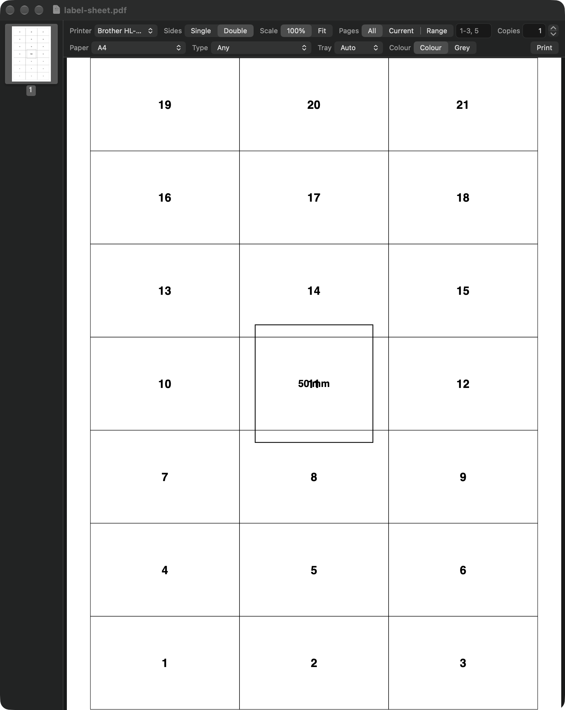

# roneo

[](https://github.com/lockyc/roneo/releases/latest)


[](LICENSE)

Printing a PDF from Preview means a trip through the print dialog every time: flip between
single- and double-sided, then find the scale setting and move it from Scale to Fit to 100%.
roneo is a fast native PDF viewer that keeps those controls in the window. The print bar shows
every setting the job will use, and Print sends the PDF straight to the printer at true 100%.



## Install

```bash
curl -fsSL https://raw.githubusercontent.com/lockyc/roneo/main/install.sh | bash
```

Needs macOS 27 or later. The installer downloads the latest release, checks that it is signed and
notarized, and installs `/Applications/roneo.app`. roneo then updates itself (**roneo → Check for
Updates…** checks now).

To build from source you need Xcode's Swift toolchain and [`just`](https://github.com/casey/just):

```bash
git clone https://github.com/lockyc/roneo && cd roneo
just run      # build and launch build/roneo.app
```

## Features

- **Viewer.** Continuous scroll, a thumbnail sidebar (⌥⌘2), zoom, Find (⌘F), go to page (⌥⌘G).
  The view reloads when the file changes on disk, so a regenerated PDF reprints without
  reopening. Windows reopen where you left them. **roneo → Make roneo the default PDF viewer**
  sets it as the app PDFs open in.
- **The print bar.** Always visible above the page: Printer, Sides (Single or Double), Scale
  (100% or Fit), Pages (All, Current or a Range), Copies, then Paper, Type, Tray and Colour or
  Grey as the printer offers them. Every new window starts from the same defaults: the system
  default printer, its own sides, paper, type, tray and colour, 100%, all pages, one copy.
  Double binds on the long edge, or the short edge when the first page is landscape.
- **What Print sends.** The Print button sends the PDF file itself to the printer, never a
  re-rendering: exact 100% unless Fit is chosen, with no system dialog. ⌘P opens **File → Print
  with System Dialog…** for anything else. The bar then shows the job's state until the next
  print.
- **Locked and no-print PDFs.** A password-protected PDF asks for its password to view and
  prints from an unlocked copy. One that forbids printing keeps Print disabled, with the reason
  in its tooltip.

## Limits

- No editing, annotation or merging: roneo views and prints.
- No tabs; each PDF has its own window.
- Print settings are never remembered: a new window starts from the defaults.
- The bar offers the selected printer's options as CUPS reports them. A control the printer lacks
  stays disabled, and settings beyond the bar's need the system dialog.

## Status

Early, pre-1.0.

## Development

```bash
just test     # unit tests
just gate     # build, tests, shellcheck
just run      # build and launch build/roneo.app
just fixtures # write test PDFs to build/fixtures
just perf build/fixtures/long.pdf   # median time to first page, five launches
```

How it's built: [docs/architecture.md](docs/architecture.md). Conventions and the release process:
[CLAUDE.md](CLAUDE.md).

## License

MIT — see [LICENSE](LICENSE).
