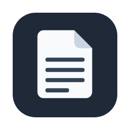

# roneo

[](https://github.com/lockyc/roneo/releases/latest)


[](LICENSE)

Printing a PDF from Preview means a trip through the print dialog every time: flip between
single- and double-sided, then find the scale setting and move it from Scale to Fit to 100%.
roneo is a fast native PDF viewer that keeps those controls in the window. The print bar shows
every setting the job will use, and Print sends the PDF straight to the printer at true 100%.

## Install

```bash
curl -fsSL https://raw.githubusercontent.com/lockyc/roneo/main/install.sh | bash
```

Needs macOS 27 or later. The installer downloads the latest release, checks that it is signed and
notarized, and installs `/Applications/roneo.app`.

To build from source you need Xcode's Swift toolchain and [`just`](https://github.com/casey/just):

```bash
git clone https://github.com/lockyc/roneo && cd roneo
just run      # build and launch build/roneo.app
```

## Status

Pre-release, under construction.

## Development

```bash
just test     # unit tests
just gate     # build, tests, shellcheck
just run      # build and launch build/roneo.app
```

How it's built: [docs/architecture.md](docs/architecture.md). Conventions and the release process:
[CLAUDE.md](CLAUDE.md).

## License

MIT — see [LICENSE](LICENSE).
